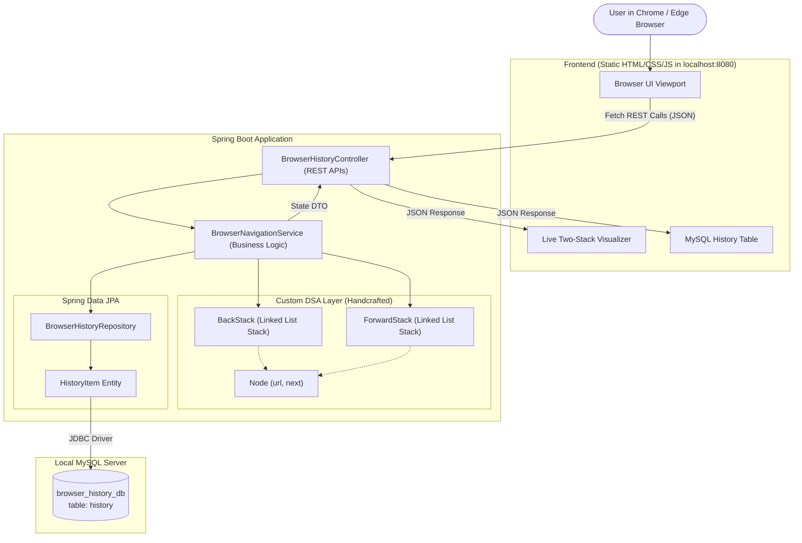

# 🌐 Browser History Simulator
### College Java DSA Mini-Project &bull; Two-Stack Architecture &bull; Spring Boot &bull; MySQL

A full-stack, local web application simulating modern browser navigation (Address Bar, Visit, Back, Forward, History, and Clear History) built from scratch for a college **Data Structures & Algorithms (DSA)** mini-project.

---

## 📌 Table of Contents
1. [Project Introduction](#-project-introduction)
2. [Features](#-features)
3. [Technology Stack](#-technology-stack)
4. [System Architecture](#-system-architecture)
5. [DSA Explanation: Two-Stack Mechanism](#-dsa-explanation-two-stack-mechanism)
6. [Navigation Algorithms (Step-by-Step)](#-navigation-algorithms-step-by-step)
7. [Time & Space Complexity Analysis](#-time--space-complexity-analysis)
8. [Database Structure (MySQL)](#-database-structure-mysql)
9. [REST API Documentation](#-rest-api-documentation)
10. [Step-by-Step Local Setup Guide (Windows)](#-step-by-step-local-setup-guide-windows)
11. [College Viva Questions & Answers](#-college-viva-questions--answers)

---

## 📖 Project Introduction

Whenever you use web browsers like Google Chrome, Mozilla Firefox, or Apple Safari, clicking the **Back (&larr;)** and **Forward (&rarr;)** buttons seamlessly navigates between visited websites.

This behavior is powered by a classic computer science data structure: **The Stack (LIFO - Last In, First Out)**.

In this mini-project:
- We **manually implement** two custom Java Stack classes (`BackStack` and `ForwardStack`) using custom Linked List `Node` objects without using Java's built-in `java.util.Stack` or `Deque`.
- We expose clean **REST APIs** via **Spring Boot 3**.
- We persist visiting records into a local **MySQL database** (`browser_history_db`) using **Spring Data JPA**.
- We provide a responsive, browser-like frontend with a **live visualizer** that displays the stacks in real time as navigation occurs.

---

## ✨ Features

1. **Browser Navigation Bar**: Complete with Back, Forward, Refresh, Home, and Omnibox URL input.
2. **Custom DSA Stacks**: Handcrafted `BackStack` and `ForwardStack` with `push()`, `pop()`, `peek()`, `isEmpty()`, and `size()`.
3. **Live Two-Stack Visualizer**: Watch URLs enter and leave stacks with explicit `TOP` pointer indicators.
4. **Interactive Simulated Webpages**: Beautiful dynamic mock renders of visited sites (Google, YouTube, GitHub, Wikipedia, or generic site cards).
5. **Quick-Visit Pills**: Single-click testing for popular test URLs.
6. **Smart Button States**: Back and Forward buttons dynamically disable when their respective stacks are empty.
7. **MySQL History Logging**: Automatically timestamps and persists visits with auto-increment ID in `history` table.
8. **Clear History**: Wipes database records and resets active session stacks.
9. **Friendly Validation**: Catches empty or invalid URL inputs with toast notifications.
10. **Responsive Design**: Polished layout for laptops, desktops, and mobile devices.

---

## 🛠 Technology Stack

### Frontend
- **HTML5**: Semantic markup for browser window, toolbars, and visualizer panels.
- **CSS3**: Modern responsive styling with glassmorphism, flexbox, CSS grid, and animations.
- **Vanilla JavaScript (ES6+)**: Fetch API calls to Spring Boot REST endpoints, dynamic DOM rendering, and state management (No heavy frameworks like React or Angular).

### Backend
- **Java 17 or 21**: Core language for business logic and manual DSA classes.
- **Spring Boot 3.2+**: Lightweight backend framework for REST controllers and service injection.
- **Spring Data JPA / Hibernate**: Object-Relational Mapping (ORM) and persistence management.
- **Maven**: Dependency management and build tool.

### Database
- **MySQL 8.x**: Local relational database storing history logs.
- **Database Name**: `browser_history_db`
- **Table Name**: `history`

---

## 🏗 System Architecture



---

## 🥞 DSA Explanation: Two-Stack Mechanism

A **Stack** is a linear data structure that follows the **LIFO (Last In, First Out)** principle. The element inserted last is the first to be removed.

Browsers use **Two Independent Stacks**:

| Stack Name | Role in Browser | Handled Action |
|---|---|---|
| **Back Stack** | Remembers previously visited pages in reverse chronological order. | Pushed on `visit()`, popped on `goBack()`. |
| **Forward Stack** | Stores pages you left behind after clicking "Back". | Pushed on `goBack()`, popped on `goForward()`. |

### Why use a Custom Linked List for Stack?
Instead of an Array with fixed size or dynamic copying, each `Node` has:
- `url`: The website address string.
- `next`: A reference to the node underneath.
- A `top` pointer always points to the uppermost node.

```
       [ TOP ]
          |
     +---------+
     | Node 3  |  (Most recent)
     +---------+
          | next
     +---------+
     | Node 2  |
     +---------+
          | next
     +---------+
     | Node 1  |  (Oldest)
     +---------+
          | next = null
```

---

## 🚀 Navigation Algorithms (Step-by-Step)

### 1. Visiting a New URL (`visit(url)`)
```
1. Validate that input URL is not empty.
2. If currentPage is valid (and not about:blank):
       Push currentPage onto BackStack.
3. Set currentPage = new URL.
4. Clear ForwardStack (crucial: visiting a new branch destroys forward history).
5. Save { url, visited_at: now() } into MySQL history table.
6. Return updated state to frontend.
```

### 2. Clicking Back (`goBack()`)
```
1. Check if BackStack is empty. If empty, return (cannot go back).
2. Push currentPage onto ForwardStack.
3. Pop previous URL from BackStack.
4. Set currentPage = popped URL.
5. Return updated state to frontend.
```

### 3. Clicking Forward (`goForward()`)
```
1. Check if ForwardStack is empty. If empty, return (cannot go forward).
2. Push currentPage onto BackStack.
3. Pop next URL from ForwardStack.
4. Set currentPage = popped URL.
5. Return updated state to frontend.
```

### 4. Example Trace:
```
Action              Current Page        Back Stack (Top->Bottom)    Forward Stack (Top->Bottom)
------------------------------------------------------------------------------------------------
1. Visit Google     google.com          [ ]                         [ ]
2. Visit YouTube    youtube.com         [google.com]                [ ]
3. Visit GitHub     github.com          [youtube.com, google.com]   [ ]
4. Click Back       youtube.com         [google.com]                [github.com]
5. Click Back       google.com          [ ]                         [youtube.com, github.com]
6. Click Forward    youtube.com         [google.com]                [github.com]
7. Visit Wikipedia  wikipedia.org       [youtube.com, google.com]   [ ]  <- Forward cleared!
```

---

## ⏱️ Time & Space Complexity Analysis

| Operation | Custom Stack Implementation | Built-in Java Stack | Time Complexity | Space Complexity |
|---|---|---|---|---|
| `push(url)` | Insert node at head | `push()` | $\mathcal{O}(1)$ Constant | $\mathcal{O}(1)$ |
| `pop()` | Remove node at head | `pop()` | $\mathcal{O}(1)$ Constant | $\mathcal{O}(1)$ |
| `peek()` | Return top node value | `peek()` | $\mathcal{O}(1)$ Constant | $\mathcal{O}(1)$ |
| `isEmpty()` | Check `top == null` | `isEmpty()` | $\mathcal{O}(1)$ Constant | $\mathcal{O}(1)$ |
| `size()` | Return integer counter | `size()` | $\mathcal{O}(1)$ Constant | $\mathcal{O}(1)$ |

> **Viva Key Takeaway:** Every single navigation action (Visit, Back, Forward) executes in **$\mathcal{O}(1)$ Constant Time**, making browser history navigation extremely fast regardless of how many pages you visit.

---

## 🗄️ Database Structure (MySQL)

### Database: `browser_history_db`
### Table: `history`

| Column Name | Data Type | Constraint | Description |
|---|---|---|---|
| `id` | `BIGINT` | `PRIMARY KEY AUTO_INCREMENT` | Unique history record identifier |
| `url` | `VARCHAR(500)` | `NOT NULL` | Visited webpage URL |
| `visited_at` | `DATETIME` | `NOT NULL` | Timestamp when page was visited |

SQL definition (`src/main/resources/schema.sql`):
```sql
CREATE DATABASE IF NOT EXISTS browser_history_db;
USE browser_history_db;

CREATE TABLE IF NOT EXISTS history (
    id BIGINT AUTO_INCREMENT PRIMARY KEY,
    url VARCHAR(500) NOT NULL,
    visited_at DATETIME NOT NULL
);
```

---

## 📡 REST API Documentation

Base URL: `http://localhost:8080/api/browser`

| Method | Endpoint | Description | Sample Request Body | Sample Response |
|---|---|---|---|---|
| `GET` | `/state` | Get current browser navigation state | None | `{"success":true,"data":{"currentPage":"https://google.com","canGoBack":false,"canGoForward":false,...}}` |
| `POST` | `/visit` | Visit a new URL | `{"url":"google.com"}` | `{"success":true,"message":"Visited: https://google.com","data":{...}}` |
| `POST` | `/back` | Navigate back to previous page | None | `{"success":true,"message":"Navigated back","data":{...}}` |
| `POST` | `/forward` | Navigate forward to next page | None | `{"success":true,"message":"Navigated forward","data":{...}}` |
| `GET` | `/history` | Fetch all saved visits from MySQL | None | `{"success":true,"data":[{"id":1,"url":"https://google.com","visitedAt":"..."}]}` |
| `DELETE` | `/history` | Clear history table and reset stacks | None | `{"success":true,"message":"Browsing history cleared","data":{...}}` |

---

## 💻 Step-by-Step Local Setup Guide (Windows)

Follow these exact steps to run the application on your Windows computer:

### Step 1: Start MySQL Server
Make sure your local MySQL service is running:
- **Option A (If using XAMPP)**: Open XAMPP Control Panel and click **Start** next to MySQL.
- **Option B (If using MySQL Installer/Windows Service)**: Open Command Prompt or PowerShell as Administrator and run:
  ```powershell
  net start MySQL80
  ```
  *(or verify it's running via Windows Services app: `services.msc`)*

### Step 2: Create the Database in MySQL
Open MySQL Command Line Client or PowerShell and run:
```sql
mysql -u root -p
```
Enter your MySQL password (or press Enter if blank). Then run:
```sql
CREATE DATABASE IF NOT EXISTS browser_history_db;
```
*(Note: The application has `createDatabaseIfNotExist=true` configured, but creating it explicitly is recommended.)*

### Step 3: Configure Database Credentials
Open `src/main/resources/application.properties`:
```properties
spring.datasource.url=jdbc:mysql://localhost:3306/browser_history_db?createDatabaseIfNotExist=true&useSSL=false&serverTimezone=UTC&allowPublicKeyRetrieval=true
spring.datasource.username=root
spring.datasource.password=YOUR_MYSQL_PASSWORD
```
> **Security Tip:** If your MySQL has no password (common in local XAMPP setups), leave `spring.datasource.password=` empty. Alternatively, set environment variables in Windows PowerShell:
> ```powershell
> $env:DB_USERNAME="root"
> $env:DB_PASSWORD="your_password"
> ```

### Step 4: Run the Spring Boot Backend
Open a terminal in the project folder (`c:\Users\Anup Mishra\Desktop\DSUJ MINI PROJECT`):
```powershell
mvn spring-boot:run
```
*(Or if you have Maven installed: `mvn clean spring-boot:run`)*

You will see:
```text
==========================================================
🚀 Browser History Simulator is running!
🌐 Open in your browser: http://localhost:8080
==========================================================
```

### Step 5: Open the Application in Chrome
Open Google Chrome and navigate to:
```
http://localhost:8080
```
You will see the Browser History Simulator interface with the live two-stack visualizer and MySQL history table.

### Step 6: How to Stop the Application
In the terminal where Spring Boot is running, press:
```
Ctrl + C
```
and confirm with `Y`.

---

## 🎓 College Viva Questions & Answers

Here are standard questions examiners frequently ask for DSA projects:

#### Q1. Why do we need two stacks to simulate browser history instead of one?
**Answer:** A single stack can only record backward history. When you click "Back", that previous page must be stored somewhere so that clicking "Forward" can restore it. Using two stacks (`BackStack` and `ForwardStack`) allows bidirectional movement between visited pages.

#### Q2. What is the time complexity of the Back and Forward operations?
**Answer:** Both are **$\mathcal{O}(1)$ Constant Time**. In our custom linked list stack, inserting (`push`) and deleting (`pop`) always happen at the `top` (head) pointer. We never need to iterate through elements.

#### Q3. Why did you use a Linked List rather than an Array for your custom Stack?
**Answer:**
1. A linked list stack grows and shrinks dynamically in memory without needing a predefined fixed capacity.
2. In an array-based stack, resizing requires copying elements into a larger array ($\mathcal{O}(n)$ amortized). A linked list node allocation is always $\mathcal{O}(1)$.

#### Q4. What happens to the Forward Stack when a user visits a new URL?
**Answer:** The **Forward Stack is cleared**. In browser navigation, visiting a new URL creates a new browsing branch. Any previously visited "forward" pages from a prior back navigation become unreachable and are discarded according to standard browser specifications.

#### Q5. What is the difference between `peek()` and `pop()`?
**Answer:** 
- `peek()` inspects and returns the value at the top of the stack **without removing** it.
- `pop()` removes the top element from the stack and returns its value.

#### Q6. What is Stack Underflow, and how does your code prevent crashes?
**Answer:** Stack Underflow occurs when an attempt is made to pop or peek from an empty stack (`top == null`). In our code, `isEmpty()` is checked before popping, and friendly exceptions/messages are returned instead of throwing a `NullPointerException`.

#### Q7. How does Spring Data JPA interact with MySQL in your project?
**Answer:** We defined the `HistoryItem` entity with `@Entity` and `@Table(name = "history")`. The `BrowserHistoryRepository` extends `JpaRepository<HistoryItem, Long>`, which automatically generates SQL queries (`INSERT`, `SELECT`, `DELETE`) without writing boilerplate JDBC code.

#### Q8. Why are static frontend files stored in `src/main/resources/static/`?
**Answer:** Spring Boot automatically serves static assets (HTML, CSS, JavaScript) from the `static` directory at the root URL `http://localhost:8080/`. This eliminates CORS (Cross-Origin Resource Sharing) problems and avoids running a separate Node/React server.

---

## 👨‍💻 Author & Project Info
- **Project Name:** Browser History Simulator
- **Course:** Data Structures & Algorithms with Java (DSUJ)
- **Year:** 2026
- **Architecture:** 2-Stack DSA + Spring Boot REST + Spring Data JPA + MySQL
